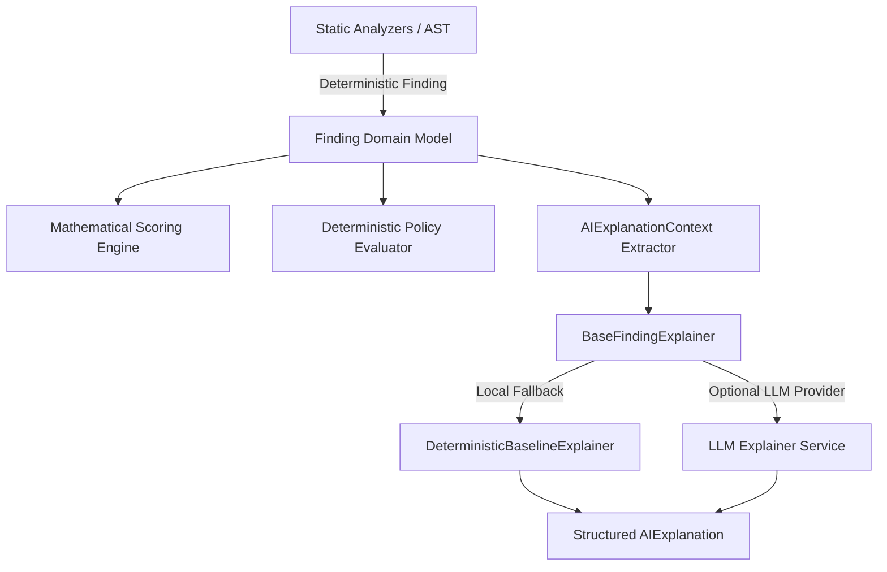

# Entropy AI Explanation & Remediation Architecture

## 1. Architectural Philosophy & Grounding

In alignment with **Article II (Rule 8)** of the *Entropy Engineering Constitution*:
> **"AI Explains Findings, Not Invents Them."**  
> The AI layer provides contextual architectural explanations and suggested refactoring diffs grounded strictly in static analysis evidence.

Entropy maintains an absolute boundary between **deterministic static analysis** and **probabilistic AI generation**:
1. **Zero Hallucination / No Invented Findings**: All findings originate strictly from AST analysis and deterministic pattern matchers (Python AST, Tree-Sitter). An LLM is never invoked to discover or invent security debt.
2. **Deterministic Scoring**: The Debt Score (0–100), severity weights, and policy pass/fail determinations are computed via pure, deterministic mathematics. AI never influences, increments, or decrements scores.
3. **Strict Advisory Disclaimer**: Every AI explanation and refactoring recommendation carries an immutable advisory notice:
   ```
   AI-generated explanation — advisory only. Does not alter deterministic findings or scores.
   ```
4. **Context Isolation**: Only minimal, structured context from the deterministic finding is provided to the explainer. Raw repository files are never streamed wholesale to an external model.

---

## 2. Core Components & Interfaces

The AI Explanation layer is defined in `app.models.domain.ai_explanation` and `app.ai.explainer`:



### 2.1 Domain Models (`app.models.domain.ai_explanation`)

#### `AIExplanation`
Represents the structured explanation payload presented to developers:
- `finding_id`: Unique identifier of the underlying deterministic finding.
- `summary`: Executive overview of the observed debt pattern.
- `why_it_matters`: Architectural or security risk justification.
- `evidence_explanation`: Contextual explanation grounded strictly in the snippet evidence.
- `architectural_impact`: Long-term technical debt and maintenance velocity hazard.
- `remediation`: Step-by-step guidance to refactor the code idiomatically.
- `suggested_pattern`: Recommended pattern or architectural design.
- `confidence`: Confidence of the explanation (independent from the finding's confidence).
- `model`: Identifier of the model or provider that generated the explanation.
- `prompt_version`: Version identifier of the prompt template used.
- `disclaimer`: Advisory notice.

#### `AIExplanationContext`
Controlled data transfer object containing the minimal context required for explanation:
- `rule_id`: e.g., `ENT-ERR-001`, `ENT-AUTH-002`
- `category`: The debt category (e.g., `error_handling`, `input_validation`)
- `severity` & `confidence`: Deterministic finding attributes
- `message`: Specific diagnostic message
- `file_path`, `line_start`, `line_end`: Source coordinates
- `evidence`: Exact syntax slice captured by the analyzer
- `source_snippet`: Surrounding context (bounded to maximum 20 lines)

---

## 3. Explainer Implementations (`app.ai.explainer`)

### 3.1 `BaseFindingExplainer`
Abstract interface defining the contract:
```python
class BaseFindingExplainer(ABC):
    @abstractmethod
    def explain(self, finding: Finding) -> FindingExplanation:
        """Provide architectural explanation for a finding."""
        ...

    @abstractmethod
    def suggest_refactor(self, finding: Finding) -> RefactoringSuggestion:
        """Provide a refactored code example for a finding."""
        ...
```

### 3.2 `DeterministicBaselineExplainer`
The default, offline, dependency-free explainer included in Entropy. It generates reliable, fully grounded explanations derived directly from rule metadata and verbatim code evidence without making external network calls or incurring API costs.

---

## 4. Prompt Engineering & Guardrails

When integrating an LLM provider into the explanation pipeline:

1. **System Prompt Guardrails**:
   - Instruct the model to strictly reason within the provided code snippet.
   - Forbid the model from speculating about code outside the provided lines.
   - Forbid claiming the code was written by AI or asserting author identity.
2. **Context Bounds**:
   - Snippets are truncated to prevent prompt injection or context overflow.
   - File paths are sanitized to prevent disclosing local environment paths.
3. **Structured Output Validation**:
   - All LLM outputs must validate against the Pydantic schema `AIExplanation`.
   - If an LLM response fails schema validation or times out, the system automatically falls back to `DeterministicBaselineExplainer`.

---

## 5. Security & Privacy Safeguards

- **No Repository Ingestion**: Scanned repositories are analyzed locally. Only the specific finding snippet (at most a few lines) is included in an explanation request.
- **Redaction of Secrets**: If the finding originates from `LoggingAndSecretsAnalyzer` (`ENT-SEC-*`), candidate secret strings are masked before context extraction.
- **CI/CD Hermeticity**: In CI/CD policy enforcement pipelines (`entropy scan --policy`), AI explanations are bypassed entirely. Policy decisions rely exclusively on deterministic criteria (score thresholds, blocking rules, severity gates).
