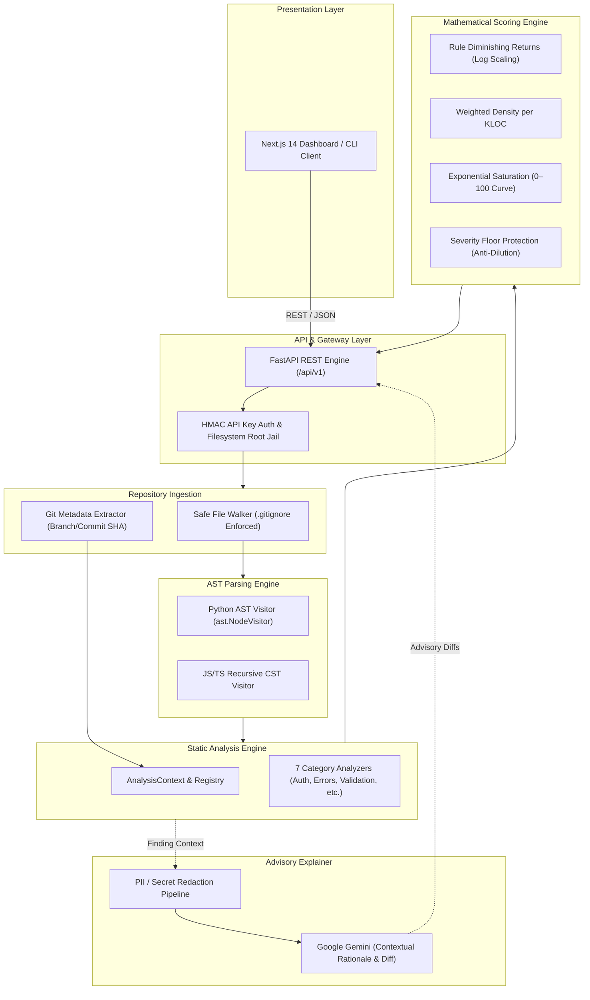

# Entropy: Comprehensive Technical Architecture & Deep-Dive Specification

> **Architectural Security-Debt Analyzer for AI-Assisted Codebases**  
> *Authoritative Engineering Reference & Mathematical Specification*

---

## Table of Contents
1. [Executive Summary & Core Philosophy](#1-executive-summary--core-philosophy)
2. [The Non-Attribution Covenant](#2-the-non-attribution-covenant)
3. [End-to-End System Topology](#3-end-to-end-system-topology)
4. [The 8-Layer Architectural Pipeline](#4-the-8-layer-architectural-pipeline)
   - [Layer 1: Repository Ingestion & Discovery](#layer-1-repository-ingestion--discovery)
   - [Layer 2: Multi-Language AST Parsing](#layer-2-multi-language-ast-parsing)
   - [Layer 3: Static Analysis Engine (7 Categories)](#layer-3-static-analysis-engine-7-categories)
   - [Layer 4: Finding Generation & Fingerprinting](#layer-4-finding-generation--fingerprinting)
   - [Layer 5: Mathematical Scoring Engine](#layer-5-mathematical-scoring-engine)
   - [Layer 6: Policy Engine & Delta Baselines](#layer-6-policy-engine--delta-baselines)
   - [Layer 7: Grounded AI Explanations](#layer-7-grounded-ai-explanations)
   - [Layer 8: Presentation Tier (API & Dashboard)](#layer-8-presentation-tier-api--dashboard)
5. [Mathematical Scoring Model Derivation](#5-mathematical-scoring-model-derivation)
   - [Rule-Level Logarithmic Diminishing Returns](#step-1-rule-level-logarithmic-diminishing-returns)
   - [Codebase Scale & KLOC Floor](#step-2-codebase-scale--kloc-floor)
   - [Asymptotic Exponential Saturation](#step-3-asymptotic-exponential-saturation)
   - [High-Impact Severity Floors](#step-4-high-impact-severity-floors)
   - [Dynamic Category Weight Normalization](#step-5-dynamic-category-weight-normalization)
6. [Technology Stack Rationale](#6-technology-stack-rationale)
7. [The 10 Inviolable Engineering Rules](#7-the-10-inviolable-engineering-rules)

---

## 1. Executive Summary & Core Philosophy

### The Threat Model of AI-Assisted Development
As development teams increasingly leverage generative AI coding assistants (Copilot, Claude, Cursor, Gemini), software development velocity has accelerated dramatically. However, AI assistants optimize for local completion rather than global architectural coherence.

This dynamic generates a new class of risk: **Architectural Security Debt**.

```
┌────────────────────────────────────────────────────────────────────────┐
│                   VULNERABILITY vs. ARCHITECTURAL DEBT                 │
├──────────────────────────────────┬─────────────────────────────────────┤
│   Traditional SAST / DAST Focus  │       Entropy Core Focus            │
├──────────────────────────────────┼─────────────────────────────────────┤
│ • SQL Injection strings (`' OR 1`)│ • Broad exception swallowing        │
│ • Known CVE dependencies         │ • Missing route authentication      │
│ • Buffer overflows               │ • Fragmented validation logic       │
│ • Hardcoded passwords (regex)    │ • Circular module dependencies      │
│ • Immediate exploitability today │ • High Shannon entropy string leaks │
│                                  │ • Structural code duplication       │
└──────────────────────────────────┴─────────────────────────────────────┘
```

Architectural Security Debt does not necessarily represent an immediately exploitable zero-day on day one. Rather, it creates structural fragility, unmonitored attack surfaces, and masked failures that accumulate compound risk over time.

---

## 2. The Non-Attribution Covenant

> [!IMPORTANT]
> **Anti-Hallucination Law (Engineering Constitution, Article II)**  
> *"The Entropy Score is an indicator of architectural and security debt detected by Entropy's static-analysis rules. It is not a vulnerability probability and does not measure AI authorship."*

Entropy explicitly rejects the concept of "AI code detection" for three fundamental reasons:
1. **Statistical Unreliability**: Stylistic watermarking and statistical classifiers produce prohibitive false-positive rates on standard boilerplate.
2. **Defect Liability**: Attributing defects to *author identity* (human vs. machine) alienates developers. The object of analysis must always be the **verifiable code syntax**.
3. **Product Integrity**: Entropy will never compute an "AI percentage", "authorship score", or predict future vulnerabilities.

All findings trace strictly to observable Abstract Syntax Tree (AST) patterns.

---

## 3. End-to-End System Topology



---

## 4. The 8-Layer Architectural Pipeline

### Layer 1: Repository Ingestion & Discovery
*Location: [`backend/app/repository/`](../backend/app/repository/)*

The ingestion layer scans local or remote git checkouts while enforcing strict safety invariants:
- **Zero Code Execution**: Repository code is treated strictly as passive text. No modules are ever imported into the Python runtime (`importlib` is barred).
- **Gitignore Respect**: Integrates `pathspec` to evaluate `.gitignore` hierarchies.
- **Noise Reduction Exclusions**: Non-production directories (`tests/`, `examples/`, `docs/`, `fixtures/`, `bench/`) are excluded by default to avoid inflating debt with mock test routes.
- **Safety Boundaries**: Files $>2\text{ MB}$ or non-UTF-8 binary files are skipped with audit logging.

### Layer 2: Multi-Language AST Parsing
*Location: [`backend/app/parser/`](../backend/app/parser/)*

Instead of error-prone regular expressions, Entropy constructs complete syntax representations:
- **Python AST**: Leverages Python standard library `ast` with custom error tolerance. Recovers function definitions, async coroutines, decorators, exception handlers, and variable assignments.
- **JavaScript & TypeScript CST**: A recursive visitor that analyzes Express, Fastify, Next.js, Hono, and NestJS constructs, tracking middleware mounts, function chains, and route guards.
- **Fault Tolerance**: Parsing errors inside individual files produce non-fatal diagnostic records without interrupting the rest of the scan.

### Layer 3: Static Analysis Engine (7 Categories)
*Location: [`backend/app/analyzers/`](../backend/app/analyzers/)*

| Category | Key Identifiers | Weight | Core Detection Mechanics |
| :--- | :--- | :---: | :--- |
| **Authentication Consistency** | `authentication_consistency` | **0.20** | Extracts routes across 8 frameworks. Detects missing route guards, mount-path ordering defects in Express, and discards trivial pass-through middleware. |
| **Authorization Consistency** | `authorization_consistency` | **0.20** | Identifies authenticated endpoints lacking RBAC (roles, scopes, permissions) on privileged mutating paths (e.g., `/admin/purge`). |
| **Error Handling Debt** | `error_handling` | **0.15** | Detects bare `except:`, broad `except Exception:` with swallowed exceptions (`pass`, return `None` or `{}`), and unhandled Promise rejections. |
| **Input Validation Debt** | `input_validation` | **0.15** | Flags unvalidated request parameters reaching execution sinks (`cursor.execute(f"...")`, raw SQL template literals) without Pydantic/Zod schemas. |
| **Logging & Secrets Debt** | `logging_and_secrets` | **0.15** | Detects Shannon entropy spikes ($H > 3.2$), credential signatures (AWS, JWTs, private keys), and unredacted PII in log calls. |
| **Architectural Consistency** | `architectural_consistency` | **0.10** | Graph-theoretic cycle detection (Tarjan's algorithm) for circular imports, while ignoring safe `if TYPE_CHECKING:` guards. |
| **Code Duplication** | `code_duplication` | **0.05** | AST subtree fingerprinting across functions to identify copy-pasted blocks across service boundaries. |

### Layer 4: Finding Generation & Fingerprinting
*Location: [`backend/app/models/finding.py`](../backend/app/models/finding.py)*

Each finding is encapsulated as a structured, immutable record containing:
- Exact line numbers (`line_start`, `line_end`)
- Surrounding verbatim code evidence snippet
- Rule ID, category, severity (`CRITICAL`, `HIGH`, `MEDIUM`, `LOW`, `INFO`), and confidence (`HIGH`, `MEDIUM`, `LOW`)

#### Line-Drift Invariant Fingerprinting
To track findings across git commits when code shifts up or down, fingerprints exclude volatile line numbers:
$$\text{Fingerprint} = \text{SHA256}(\text{rule\_id} \,\|\, \text{relative\_path} \,\|\, \text{symbol\_name} \,\|\, \text{ast\_node\_structure})$$

### Layer 5: Mathematical Scoring Engine
*Location: [`backend/app/scoring/`](../backend/app/scoring/)*

Consumes the list of structured findings and computes the deterministic 0–100 Entropy Debt Score. Complete mathematical derivation is detailed in [Section 5](#5-mathematical-scoring-model-derivation).

### Layer 6: Policy Engine & Delta Baselines
*Location: [`backend/app/policy/`](../backend/app/policy/)*

Enables teams to integrate Entropy into GitHub Actions and CI/CD pipelines via `.entropy-policy.yaml`:
```yaml
version: "1.0"
fail_on_tier: HIGH
fail_on_new_critical: true
max_score_delta: 0.0  # PR must not increase architectural debt
```
Computes delta sets ($\text{Findings}_{\text{current}} \setminus \text{Findings}_{\text{base}}$) and outputs OASIS **SARIF 2.1.0** reports for GitHub Code Scanning tabs.

### Layer 7: Grounded AI Explanations
*Location: [`backend/app/ai/`](../backend/app/ai/)*

- **Strictly Advisory**: AI models (Google Gemini) are read-only. They never create findings or alter scores.
- **Redaction Pipeline**: Source code evidence is scrubbed of API keys, tokens, auth headers, and IP addresses before transmission.
- **Structured Schema**: Generates an architectural explanation, why the defect matters, step-by-step remediation, and a concrete refactored diff.

### Layer 8: Presentation Tier (API & Dashboard)
*Location: [`frontend/`](../frontend/)*

- Built with **Next.js 14**, **React**, and **Tailwind CSS**.
- **Source of Truth Rule**: The frontend is purely a presentation layer. It **never** recalculates or approximates security scores; every metric originates from the backend scoring engine.

---

## 5. Mathematical Scoring Model Derivation

The scoring model is designed to satisfy three formal criteria:
1. **Scale Invariance**: A defect density of 1 Medium defect per 100 LOC yields the same score whether in a 500-line microservice or a 500,000-line monorepo.
2. **Monotonicity**: Adding any authentic defect strictly increases (or preserves) the score.
3. **Anti-Dilution (Severity Floor)**: Critical security findings in huge repositories must never be mathematically diluted to zero.

### Step 1: Rule-Level Logarithmic Diminishing Returns
For each finding $f$ generated by rule $r$:
$$\text{Points}(f) = W_{\text{severity}}(f) \times M_{\text{confidence}}(f)$$

Where weights and multipliers are strictly centralized:
- $W_{\text{severity}} \in \{ \text{CRITICAL}: 10.0, \text{HIGH}: 7.0, \text{MEDIUM}: 4.0, \text{LOW}: 1.0, \text{INFO}: 0.0 \}$
- $M_{\text{confidence}} \in \{ \text{HIGH}: 1.0, \text{MEDIUM}: 0.8, \text{LOW}: 0.5 \}$

To prevent a single repetitive rule from dominating the score, findings exceeding $N = 20$ scale logarithmically:
$$\text{Penalty}(r) = \sum_{i=1}^{\min(k, 20)} \text{Points}(f_i) + \overline{\text{Points}}_r \times 5.0 \times \ln\left(1 + \frac{k - 20}{1.0}\right)$$

The category raw penalty is:
$$\text{Raw Penalty}_c = \sum_{r \in \text{Rules}_c} \text{Penalty}(r)$$

### Step 2: Codebase Scale & KLOC Floor
$$\text{Effective LOC} = \max(\text{Total LOC}, 200)$$
$$\text{KLOC} = \frac{\text{Effective LOC}}{1000.0}$$
$$\text{Weighted Debt Density}_c = \frac{\text{Raw Penalty}_c}{\text{KLOC}}$$

### Step 3: Asymptotic Exponential Saturation
To map density onto a normalized $[0, 100]$ score, an asymptotic exponential curve with saturation constant $K = 40.0$ is applied:

$$\text{Category Score}_c = 100.0 \times \left(1.0 - e^{-\frac{\text{Weighted Debt Density}_c}{40.0}}\right)$$

```
Debt Score
100 ┌─────────────────────────────────────────────── Maximum Theoretical Debt
 80 ├──────────────────────────────────────╭──────── VERY HIGH DEBT (81–100)
 60 ├─────────────────────────────╭────────┘         HIGH DEBT (61–80)
 40 ├──────────────╭──────────────┘                  MODERATE DEBT (41–60)
 20 ├─────╭────────┘                                 LOW DEBT (21–40)
  0 ┴─────┴───────────────────────────────────────── VERY LOW / Pristine (0–20)
    0     10      20      30      40      50   Density (points / KLOC)
```

### Step 4: High-Impact Severity Floors
To protect against dilution in massive repositories:
- Any **`HIGH`** severity finding (with `HIGH` confidence) sets a minimum score of **`41`** (`MODERATE`).
- Any **`CRITICAL`** severity finding (with `HIGH` confidence) sets a minimum score of **`61`** (`HIGH`).
- Two or more ($\ge 2$) **`CRITICAL`** findings set a minimum score of **`81`** (`VERY_HIGH`).

$$\text{Final Score} = \max(\text{Score}_{\text{density}}, \text{Severity Floor})$$

### Step 5: Dynamic Category Weight Normalization
When a codebase lacks web frameworks, Authentication and Authorization are marked `NOT_ANALYZED`. Entropy dynamically normalizes the weights of analyzed categories ($\mathcal{A}$) so the score is never biased by dummy zeros:

$$w_c^{\text{rel}} = \frac{W_c}{\sum_{a \in \mathcal{A}} W_a}$$
$$\text{Overall Entropy Score} = \text{round}\left(\sum_{c \in \mathcal{A}} w_c^{\text{rel}} \times \text{Category Score}_c\right)$$

---

## 6. Technology Stack Rationale

```
┌────────────────────────────────────────────────────────────────────────┐
│                      TECHNOLOGY STACK ARCHITECTURE                     │
├─────────────────────┬──────────────────┬───────────────────────────────┤
│ Layer               │ Technology       │ Engineering Rationale         │
├─────────────────────┼──────────────────┼───────────────────────────────┤
│ Backend Runtime     │ Python 3.11+     │ Native AST standard library,  │
│                     │                  │ high-performance typing,      │
│                     │                  │ hashlib, and hmac primitives. │
├─────────────────────┼──────────────────┼───────────────────────────────┤
│ Web Framework       │ FastAPI          │ Async ASGI throughput, native │
│                     │                  │ OpenAPI spec generation, and  │
│                     │                  │ automatic Pydantic validation.│
├─────────────────────┼──────────────────┼───────────────────────────────┤
│ Schema Validation   │ Pydantic v2      │ Rust-based core serializer;   │
│                     │                  │ sub-millisecond validation of │
│                     │                  │ thousands of finding records. │
├─────────────────────┼──────────────────┼───────────────────────────────┤
│ Frontend Framework  │ Next.js 14       │ React Server/Client separation│
│                     │ (App Router)     │ for responsive dashboards.    │
├─────────────────────┼──────────────────┼───────────────────────────────┤
│ Design System       │ Tailwind CSS     │ Zero-runtime atomic styling   │
│                     │                  │ implementing obsidian/emerald │
│                     │                  │ developer tool aesthetic.     │
├─────────────────────┼──────────────────┼───────────────────────────────┤
│ CI/CD Reporting     │ OASIS SARIF      │ Native GitHub Code Scanning   │
│                     │ v2.1.0           │ integration standard.         │
├─────────────────────┼──────────────────┼───────────────────────────────┤
│ Advisory AI         │ Google Gemini    │ Long-context comprehension    │
│                     │                  │ for architectural refactoring.│
└─────────────────────┴──────────────────┴───────────────────────────────┘
```

---

## 7. The 10 Inviolable Engineering Rules

From **The Entropy Engineering Constitution (Article IV)**:

1. **No Mock Security Findings**: Every finding must trace to real AST syntax in scanned source files.
2. **No Fake Scan Results**: Never return canned responses. An empty codebase produces zero findings.
3. **No Hardcoded Dashboard Metrics**: Every number, percentage, and badge must be computed by the backend engine.
4. **No Pretending an Analyzer Exists**: If an analyzer is not implemented, its status is transparently marked `NOT_ANALYZED`.
5. **Backend is the Source of Truth**: The frontend is strictly a presentation tier and never computes or alters debt scores.
6. **Every Score Must Be Explainable**: The engine generates a step-by-step mathematical audit trail detailing raw penalties and weights.
7. **Prefer Deterministic Static Analysis Over LLM Guesses**: Static syntax inspection produces findings; LLMs do not invent them.
8. **AI Explains Findings, Not Invents Them**: AI synthesizes rationale and refactor suggestions strictly grounded in AST findings.
9. **Fail Gracefully on Parse Errors**: When a file contains syntax errors, record a non-fatal warning and continue scanning.
10. **Preserve Exact Source Locations**: Every finding must capture exact file paths, line ranges, and surrounding verbatim code snippets.
