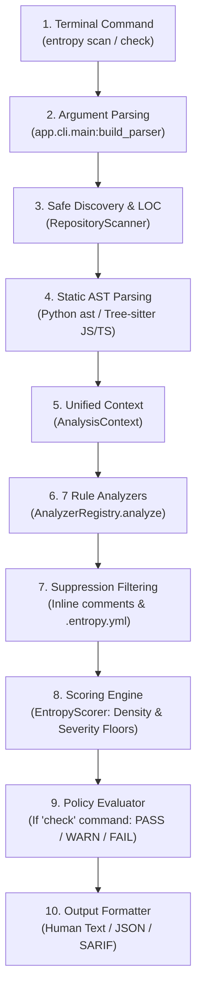

# Entropy Terminal Guide: Comprehensive Architectural & CLI Reference

This document provides an end-to-end technical explanation of how **Entropy** functions on the command line, detailing its internal execution lifecycle, AST parsing layers, 7-category rule analysis, mathematical scoring engine, and terminal CLI command suite.

---

## 1. Overview & Core Philosophy

**Entropy** is an architectural and security debt analyzer tailored for modern AI-assisted codebases across **Python**, **JavaScript**, and **TypeScript**. Rather than hunting solely for known CVEs or attempting to classify AI authorship, Entropy identifies structural design degradation: swallowed exceptions, missing security boundaries, unvalidated inputs, hardcoded secrets, and circular module architectures.

### Inviolable Invariants

1. **Zero Untrusted Code Execution:** Target code is never imported, executed, or `eval()`'d. Analysis is performed strictly in-memory using syntactic AST parsers.
2. **Determinism:** The same repository state produces identical findings and the exact same 0–100 debt score on any machine.
3. **Non-Attribution Covenant:** Entropy measures static code patterns—it never computes "AI percentage" or attributes defects to author identity. AI assistance (`entropy explain`) is strictly advisory and cannot mutate findings or scores.

---

## 2. CLI Architecture & File Layout

Entropy's command line is implemented as a standard Python console script declared in `backend/pyproject.toml`:

```toml
[project.scripts]
entropy = "app.cli.main:main"
```

The underlying pipeline is decoupled into discrete modular layers:

```
backend/app/
├── cli/
│   └── main.py                 # CLI entry point, argument parsing, output formatters
├── repository/
│   ├── scanner.py              # RepositoryScanner: safe ingestion, metadata extraction
│   └── discoverer.py           # RepositoryDiscoverer: directory walker (.gitignore)
├── parser/
│   ├── python/parser.py        # PythonParser: stdlib ast.parse wrapper
│   └── jsts/parser.py          # JSTSParser: Tree-sitter JS/TS/JSX/TSX grammar engine
├── analyzers/
│   ├── registry.py             # AnalyzerRegistry: orchestrates 7 debt analyzers
│   ├── rules/error_handling/   # Swallowed exceptions, broad catches
│   ├── security/auth/          # Authentication & authorization route guard coverage
│   ├── security/validation/    # Unsafe SQL concatenation, missing schema validation
│   ├── security/logging_secrets/ # Shannon entropy scanner, hardcoded secret patterns
│   ├── duplication/            # AST subtree hashing & duplication clustering
│   └── architecture/           # Module dependency graph & circular imports
├── scoring/
│   ├── entropy_scorer.py       # Defect density calculation, weights & severity floors
│   └── weights.py              # Mathematical saturation factors & constants
└── policy/
    ├── evaluator.py            # Policy evaluation engine (.entropy-policy.yaml)
    └── models.py               # Policy pass/warn/fail thresholds
```

---

## 3. Terminal Execution Lifecycle

When you invoke `entropy scan [path]` or `entropy check [path]`, the CLI runs the unified pipeline `_run_single_scan_pipeline`:



### Step 1: Ingestion & Discovery
- **Path Resolution:** Resolves target directory without requiring dangerous network calls.
- **Git Metadata Extraction:** Reads branch name, HEAD commit SHA, and remote URL safely via `GitService` using direct argument arrays (no shell interpolation).
- **Scope Filtering:** Honors `.gitignore`, automatically skips build artifacts (`node_modules`, `.venv`, `.git`, `dist`, `build`), and excludes test files/fixtures unless `--include-tests` is specified.
- **LOC Measurement:** Computes non-blank, non-comment lines of code across all supported languages.

### Step 2: In-Memory Static AST Parsing
- **Python:** Parsed into `ParsedPythonUnit` using Python's native `ast.parse`. It never invokes `importlib` or executes Python code.
- **JavaScript & TypeScript:** Parsed into `ParsedJSTSUnit` using native C-bindings via `Tree-sitter` (`tree-sitter-javascript` and `tree-sitter-typescript`). No Node.js runtime is required.

### Step 3: Rule Analyzers (7 Debt Categories)
The 7 registered analyzers inspect the AST context:
1. **Error Handling Debt (`ENT-ERR-*`):** Unhandled promise rejections, swallowed exceptions (`try...except: pass`), and overly broad catch statements.
2. **Authentication Consistency (`ENT-AUTH-*`):** Unprotected HTTP endpoints, route declaration order bypasses in Express/Fastify/Next.js/FastAPI, missing decorators or guards.
3. **Authorization Consistency (`ENT-AZ-*`):** Inconsistent role-based access controls (RBAC), missing `@Roles` or scope enforcement on sensitive routes.
4. **Input Validation Debt (`ENT-VAL-*`):** Unsanitized SQL string formatting/concatenation in DB execution calls, missing Pydantic / Zod / Joi validation schemas.
5. **Logging & Secrets Debt (`ENT-LOG-*`):** String literals with high Shannon entropy (>3.2), regex secret pattern matches (tokens, private keys), unredacted logging of credentials.
6. **Code Duplication & Boilerplate (`ENT-DUP-*`):** Structural AST subtree hashing across functions to detect copy-paste maintenance burdens.
7. **Architectural Consistency (`ENT-ARCH-*`):** Cyclic import dependency graphs and architectural layer boundary violations.

### Step 4: Suppressions & Project Configuration
- Scans for inline comments (e.g. `# entropy:disable ENT-ERR-001`).
- Reads repository `.entropy.yml` to apply repository-wide rule ignores or path exemptions.

### Step 5: Scoring Model & Math
Entropy calculates an authoritative score from **0 to 100**:
- **Defect Density ($D$):**
  $$D = \frac{\sum (w_i \cdot \text{findings}_i)}{\text{KLOC}}$$
  Where $\text{KLOC} = \max(\text{Lines of Code} / 1000, 0.2)$ (enforcing a 200 LOC floor to prevent score explosion on small projects).
- **Asymptotic Saturation Curve:**
  $$\text{Score}_{\text{density}} = 100 \times \left(1 - e^{-\frac{D}{\lambda}}\right)$$
- **Severity Floors:** A single high-confidence `CRITICAL` finding sets a floor of at least **61 (High)**. Multiple `CRITICAL` findings trigger an automatic floor of **81 (Very High)**, ensuring severe vulnerabilities cannot be buried by a high volume of clean lines.

### Step 6: Terminal Formatting & Exit Code Dispatch
- **Text:** Terminal tables, category summaries, and top finding details formatted with Unicode dividers.
- **JSON:** Complete serialized object containing scan metadata, file counts, categories, and findings array.
- **SARIF:** Static Analysis Results Interchange Format (v2.1.0) compatible with GitHub Code Scanning, SonarQube, and VS Code SARIF viewers.

---

## 4. Complete CLI Command Reference

### Global Flags

```bash
entropy [--version] [--no-color] [--quiet | -q] [--verbose | -v] <subcommand>
```

- `--version`: Print `entropy 0.1.0` and exit.
- `--no-color`: Disable ANSI color escapes (ideal for plain log sinks).
- `--quiet, -q`: Suppress banners and progress logs, outputting only scan results or errors.
- `--verbose, -v`: Enable verbose debug logging to `stderr`.

---

### Command Guide

#### 1. `entropy scan [path]`
Scans a repository path (default: current directory `.`), executes all 7 analyzers, calculates debt score, and prints results.

```bash
# Basic scan
entropy scan .

# Output formatted as JSON
entropy scan /path/to/project --format json

# Output SARIF for CI/CD integration
entropy scan . --format sarif > results.sarif

# Include test, fixture, and mock files
entropy scan . --include-tests

# Fail if new findings exist relative to baseline
entropy scan . --fail-on-new
```

#### 2. `entropy check [path]` *(Primary CI Gate)*
Scans the repository and evaluates findings and score against policy rules (defaulting to built-in rules or `.entropy-policy.yaml`).

```bash
# Primary CI check
entropy check .

# Check with custom policy file
entropy check . --policy .entropy-policy.yaml

# Treat warnings as hard failures (exit code 1)
entropy check . --fail-on-warn

# Machine-readable JSON output for automated PR bots
entropy check . --format json
```

#### 3. `entropy findings [path]`
Inspects granular findings with specialized filtering options.

```bash
# View all findings
entropy findings .

# Filter by severity
entropy findings . --severity high

# Filter by category
entropy findings . --category logging_and_secrets

# Filter by rule ID
entropy findings . --rule ENT-ERR-002

# Filter by file path substring
entropy findings . --file auth

# Show only findings introduced since the last baseline
entropy findings . --new

# Show suppressed findings and reasons
entropy findings . --suppressed
```

#### 4. `entropy baseline`
Manages baseline snapshots (`.entropy-baseline.json`) for incremental debt gating.

```bash
# Snapshot current repository state as baseline
entropy baseline create .

# View baseline score, commit SHA, and finding count
entropy baseline show .

# Re-scan and update existing baseline
entropy baseline update .

# Clear / delete baseline file
entropy baseline clear . --yes
```

#### 5. `entropy compare <base> <head>`
Compares debt scores and finding deltas between two directories or scan IDs.

```bash
# Compare two folders (e.g. main branch vs feature branch)
entropy compare ../repo-main ../repo-feature

# Compare two stored scan IDs
entropy compare scan_abc123 scan_def456
```

#### 6. `entropy explain <finding-id>`
Generates an advisory AI explanation and remediation recommendation for a specific finding using Gemini.

```bash
entropy explain finding_7a9f1b2c
```
> [!NOTE]
> AI explanations are strictly advisory. They never modify the finding ID, rule classification, severity, or the mathematical debt score.

#### 7. `entropy init [path]`
Generates a starter `.entropy.yml` configuration file in the target directory.

```bash
entropy init .
```

#### 8. `entropy config validate [path]`
Validates the syntax and schema of an existing `.entropy.yml`.

```bash
entropy config validate
```

#### 9. `entropy policy validate <file>` & `evaluate`
Validates policy definitions or evaluates saved scan JSON files against a policy.

```bash
# Validate policy syntax
entropy policy validate .entropy-policy.yaml

# Evaluate offline scan result against policy
entropy policy evaluate --policy .entropy-policy.yaml --scan-file scan.json --fail-on-warn
```

---

## 5. Exit Codes & CI/CD Pipeline Gating

Entropy outputs standard exit codes to integrate directly with build tools and CI pipelines:

| Exit Code | Status | Meaning |
| :---: | :--- | :--- |
| **`0`** | `PASS` | Analysis completed successfully; all policy rules passed (or warnings allowed). |
| **`1`** | `POLICY FAIL` | Policy violated (score exceeded limit, or new critical findings detected), or warning with `--fail-on-warn`. |
| **`2`** | `CONFIG ERROR` | Schema error in `.entropy.yml` or policy file, or missing baseline when `--fail-on-new` is used. |
| **`3`** | `SYSTEM ERROR` | Target directory does not exist, unhandled exception, or filesystem permission error. |

### Example GitHub Actions CI Workflow

```yaml
name: Entropy Architectural Gate

on:
  pull_request:
    branches: [main]
  push:
    branches: [main]

jobs:
  entropy-gate:
    runs-on: ubuntu-latest
    steps:
      - uses: actions/checkout@v4

      - name: Setup Python
        uses: actions/setup-python@v5
        with:
          python-version: "3.11"

      - name: Install Entropy CLI
        run: pip install -e backend

      - name: Run Entropy Policy Check
        run: entropy check . --fail-on-warn

      - name: Generate SARIF Security Report
        if: always()
        run: entropy scan . --format sarif > entropy.sarif

      - name: Upload SARIF to GitHub Code Scanning
        if: always()
        uses: github/codeql-action/upload-sarif@v3
        with:
          sarif_file: entropy.sarif
```

---

## 6. How to Run on Windows Terminal

When running on Windows PowerShell or CMD:

### 1. Set UTF-8 Console Output
Entropy uses Unicode box-drawing characters (`─`, `✓`, `❌`). Ensure your terminal environment handles UTF-8:
```powershell
$env:PYTHONIOENCODING="utf-8"
```

### 2. Run via `uv` or Virtual Environment
```powershell
cd "C:\Users\VISHANTH R\Downloads\entropy-main\backend"

# Scan current directory
uv run entropy scan .

# Run CI gate check
uv run entropy check .

# Filter high-severity findings
uv run entropy findings . --severity high

# Inspect established baseline
uv run entropy baseline show .
```

---

## 7. Sample Terminal Outputs

### Human Text (`entropy scan .`)
```text
Entropy Scan
────────────────────────────
Repository: C:\Users\VISHANTH R\Downloads\entropy-main\backend

Category Breakdown (Primary Output)
────────────────────────────
Categories:
  Error Handling             Score: 20.8      (107 findings)
  Authentication             Score: 1.8       (11 findings)
  Authorization              Score: 2.2       (6 findings)
  Input Validation           Score: 0.4       (1 finding)
  Logging & Secrets          Score: 2.5       (5 findings)
  Code Duplication           Score: 8.6       (39 findings)
  Architecture               Score: 1.4       (5 findings)

Top Findings (Primary Output)
────────────────────────────
  1. [HIGH] ENT-LOG-002: Hardcoded Secret Assigned to 'FALLBACK_SECRET'
     Location: app/analyzers/security/logging_secrets/models.py:20
     Detail: Variable 'FALLBACK_SECRET' is assigned a static string literal resembling a secret.
  ... and 164 more finding(s)

Entropy Score & Scope [EXPERIMENTAL]
────────────────────────────
Entropy Score: 5 / 100 [EXPERIMENTAL] (Band: Very Low)
Coverage: 100.0% LOC analyzed
Scope Exclusions: 155 files (215,728 LOC excluded)
Files discovered: 324, Files analyzed: 146
Lines of code: 27,417
Findings: 174
```

### CI Gate Output (`entropy check .`)
```text
Entropy Check
────────────────────────────
Score: 5 / 100
Band: Very Low

Findings: 174

Baseline Comparison:
────────────────────────────
Baseline: 5 -> Current: 5 (Delta: +0)
Findings: +0 new, -0 resolved, 174 unchanged, 0 suppressed

Policy: default (status: PASS)

Result: PASS
Exit code: 0
```
